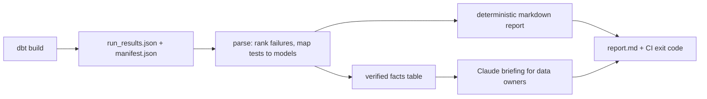

# LLM Data Quality Assistant

[](https://github.com/Saigwe/llm-data-quality-assistant/actions/workflows/ci.yml)
 



Turns a nightly **dbt test run** into a plain-English briefing that business data owners can act on.

After a dbt run, failures sit in `target/run_results.json` as cryptic test IDs. This tool:

1. **Parses** `run_results.json` (and optionally `manifest.json`) into structured findings, ranked worst-first and mapped to the model each test checks.
2. **Builds a deterministic markdown report**, which works offline and with no API key.
3. **Optionally asks Claude** (`--llm`) to write a short briefing: whether reporting can be trusted today, the business impact of each issue, likely causes and owners for the next steps.

The LLM only sees the verified table of failing tests, and the prompt forbids inventing numbers or causes. The deterministic report always ships underneath the briefing, so every claim can be checked against the source.

## Run it

```bash
pip install -r requirements.txt
python -m dq_assistant --run-results sample_artifacts/run_results.json --manifest sample_artifacts/manifest.json
```

Add the Claude briefing (needs `ANTHROPIC_API_KEY` or an `ant auth login` profile):

```bash
python -m dq_assistant --run-results sample_artifacts/run_results.json --manifest sample_artifacts/manifest.json --llm --out report.md
```

Point it at a real project's `target/` folder after `dbt build`. The exit code is `1` when any test fails or errors, so it can gate a CI job.

## Example output (deterministic part)

| Status | Test | Model | Failing rows |
|---|---|---|---|
| error | source_freshness_raw_payments | stg_payments | 0 |
| fail | not_null_fct_orders_customer_id | fct_orders | 1342 |
| fail | relationships_fct_orders_customer_id... | fct_orders | 87 |
| warn | accepted_values_fct_orders_status... | fct_orders | 12 |

## Design choices

- **Ground truth first.** The LLM rewrites verified facts; it never queries data itself. That keeps it auditable and cheap.
- **Graceful degradation.** If credentials or the network are missing, the tool falls back to the deterministic report rather than failing the pipeline.
- **Model:** `claude-opus-5-5` at `medium` effort, with server-side refusal fallback enabled.

## Tests

```bash
pytest
```

The tests cover parsing, ranking, test-to-model mapping, the report and CLI exit codes, and the Claude call (with a fake client, so they run offline).

## Walkthrough

- [ ] 3-minute Loom walkthrough ([script ready](docs/walkthrough.md))

## Stack

Python, Anthropic SDK, dbt artifacts (run_results v6), pytest.
